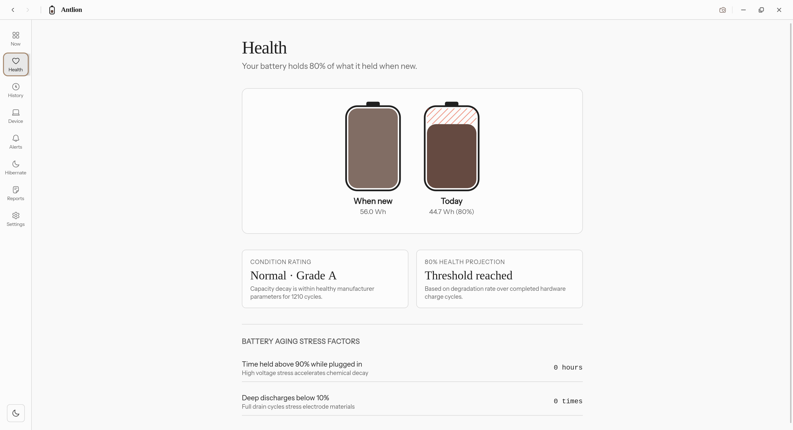

<div align="center">


# Antlion

**A calm, precision battery and power management desktop app for engineers.**  
No synthetic math. No cloud tracking. 100% direct kernel telemetry.

[](https://golang.org)
[](https://v3.wails.io)
[](https://vuejs.org)
[](https://tailwindcss.com)
[](https://modernc.org/sqlite)
[](#privacy--offline-guarantee)
[](LICENSE)

[Visual Showcase](#visual-showcase) • [Problem & Solution](#problem--solution) • [Status Matrix](#honest-status-matrix-what-works-vs-what-does-not) • [Tech Stack](#technology-stack) • [Project Tree](#project-structure) • [Running & Building](#running--building-with-wails) • [Roadmap](#future-roadmap)

</div>

---

## Visual Showcase

Antlion captures real physical telemetry directly from Linux kernel sysfs registers, rendering live fluid dynamics, real ACPI cycle degradation, and real-time power draw at 60 FPS:

<div align="center">
  
  <p><em>Live 2x Retina capture of Antlion running on Linux (HP EliteBook 850 G7) with ACPI cycle odometer and live 48-slot hourly telemetry strip.</em></p>
  <br />
  
  <p><em>Battery Health analytics showing true milliwatt-hour capacity, wear delta, high-temperature stress hours, and deep discharge counts.</em></p>
</div>

---

## Problem & Solution

### The Problem

1. **Operating System Inaccuracy**: Modern desktop OS battery meters provide a single coarse percentage and a constantly guessing "time remaining" estimate that swings wildly between "5 hours" and "40 minutes" under slight CPU bursts.
2. **Electron Bloat**: Most third-party battery utilities are packaged as Chromium/Electron runtimes that consume 300MB–500MB of RAM and 5–10% background CPU, actively draining the very battery they are monitoring.
3. **Hardcoded Math & Synthetic Data**: Common battery tools compute fake linear degradation curves, interpolate missing sensor points with arbitrary formulas, and fail entirely on multi-battery hardware (e.g. ThinkPads with internal `BAT0` and external `BAT1`).
4. **Transient State Loss**: Most tools discard session history upon closing. When your laptop reboots or wakes from suspend, the charge session history is lost.
5. **Privacy Violations**: Many popular power monitoring tools bundle analytics SDKs, crash reporters, and cloud sync services that phone home with machine serials and usage logs.

### The Solution

- **Direct Kernel Telemetry**: Reads raw voltage (`voltage_now`), micro-amperes (`current_now`), power draw (`power_now`), micro-watt-hours (`energy_now` / `charge_now`), and ACPI cycle counts directly from `/sys/class/power_supply/`.
- **Strict Zero-Mock Engineering**: Zero fake numbers, zero synthetic seed data, zero simulated curves. If hardware lacks dual batteries, the secondary vessel UI is automatically hidden.
- **Persistent Pure-Go SQLite Ledger**: Every charge and discharge session, temperature threshold event, and daily degradation snapshot is saved locally to SQLite (`~/.local/share/antlion/antlion.db`) using Write-Ahead Logging (WAL).
- **Lightweight Native Desktop Footprint**: Built with Go and Wails v3 Alpha utilizing the system's native WebKitGTK / WebView2 renderer. Memory footprint is ~15–25MB, with near-zero background CPU overhead.
- **In-App 2x Retina Snapshots**: Built-in screenshot engine (`Method A`) captures crisp 2x Retina PNGs of any view directly to `~/Downloads/` with timestamp and screen metadata.
- **100% Offline & Private**: Zero network calls. No telemetry. No analytics. No cloud accounts.

---

## Honest Status Matrix: What Works vs What Does Not

To be completely transparent about the current state of Antlion, here is what is **actually implemented and functional today** versus what is **under active construction or planned**:

| Capability | Status | Implementation Details |
| :--- | :---: | :--- |
| **Linux Kernel Telemetry** | **LIVE** | Full support for `BAT0`, `BAT1`, `AC` via `/sys/class/power_supply/`. |
| **Live Fluid Vessel & Dashboard** | **LIVE** | 60 FPS CSS liquid vessel reflecting real battery percentage and charge state. |
| **Hourly Telemetry Strip** | **LIVE** | 48 real hourly slots recording live battery levels and charge history. |
| **Pure-Go SQLite Storage** | **LIVE** | `modernc.org/sqlite` database with WAL mode for sessions, metrics, and snapshots. |
| **Session History Ledger** | **LIVE** | Records start/end time, duration, start/end %, avg/peak watts, peak temperature. |
| **Session Detail Sheet** | **LIVE** | Slide-out Radix sheet displaying granular electrical forensics for any session. |
| **Battery Health Analytics** | **LIVE** | Real design vs full capacity (mWh), true wear delta, ACPI cycle odometer. |
| **Thermal & Deep Discharge Tracking** | **LIVE** | Cumulative high-stress hours (>38°C) and deep discharge events (<15%). |
| **Hardware Polyfill (Multi-Battery)** | **LIVE** | Automatically hides `BAT1` vessel when machine has single battery. |
| **In-App Retina Snapshot (Method A)** | **LIVE** | Exports 2x DPI lossless PNG to `~/Downloads/` with screen name and timestamp. |
| **Theme System** | **LIVE** | Dark mode, Light mode, and Caffeine theme with localStorage persistence. |
| **Frameless Window & Navigation** | **LIVE** | Custom draggable titlebar, navigation rail, and directional page transitions. |
| **Automated Packaging & Releases** | **NOT YET** | **No `.deb` or `.AppImage` CI releases yet.** App must be compiled from source. |
| **System Tray Background Daemon** | **IN PROGRESS** | Window minimize-to-tray and background polling daemon are being wired up. |
| **Charge Threshold Limiter** | **PLANNED** | Setting charge limits (e.g. stop at 80%) requires PolicyKit / root daemon helper. |
| **Windows & macOS Native Drivers** | **PLANNED** | Platform interface exists; Win32 / IOKit backend implementations are upcoming. |

---

## Technology Stack

```
┌────────────────────────────────────────────────────────┐
│                   Antlion Frontend                     │
│  Vue 3.5 (Composition API) • TypeScript • Vite 6       │
│  Tailwind CSS v4 • Radix Vue • @fontsource/instrument  │
├────────────────────────────────────────────────────────┤
│                   IPC Transport Layer                  │
│       Wails v3 Alpha (RPC Bindings & Native Events)    │
├────────────────────────────────────────────────────────┤
│                    Go Core Backend                     │
│  BatteryService • DeviceService • HistoryService       │
│  ScreenshotService • HibernateService                  │
├──────────────────────┬─────────────────────────────────┤
│  Persistent Storage  │       Platform Drivers          │
│  Pure-Go SQLite WAL  │  Linux: /sys/class/power_supply │
│  (~/.local/share/...) │  (Windows/macOS stubs in place) │
└──────────────────────┴─────────────────────────────────┘
```

### Backend
- **Go 1.23+**: High-concurrency, memory-safe backend engine.
- **Wails v3 Alpha**: Lightweight desktop framework coupling Go with native system webviews (WebKitGTK on Linux).
- **SQLite (Pure-Go)**: `modernc.org/sqlite` database engine compiling directly without CGO dependencies.

### Frontend
- **Vue 3.5+**: Composition API (`<script setup lang="ts">`), reactive state management, KeepAlive view caching.
- **TypeScript 5.8+**: Strict type safety across all components, composables, and Wails RPC bindings.
- **Tailwind CSS v4**: Ultra-fast utility styling engine with CSS variable design tokens.
- **Radix Vue**: Accessible, headless primitives (Dialog, Sheet, Tooltip, Select, Switch).
- **Icons**: Hugeicons, Lucide Vue Next, custom Antlion SVG iconography.
- **Typography**: `@fontsource/instrument-sans` for high-readability engineering telemetry.

### Tooling & Code Quality
- **Bun**: Fast JavaScript package manager and test runner.
- **Oxlint & Oxfmt**: High-speed Rust-based linter and formatter.
- **ESLint**: Flat configuration (`eslint.config.ts`) for strict TypeScript and Vue validation.
- **vue-tsc**: Strict Vue template type checker.

---

## Project Structure

A comprehensive nested view of the repository:

```
antlion-app/
├── AGENTS.md                          # Engineering directives (Zero-Mock policy, quality gates)
├── README.md                          # Project documentation and architecture guide
├── Taskfile.yml                       # Wails build, dev, package, and run automation tasks
├── go.mod                             # Go module definition and dependencies
├── go.sum                             # Cryptographic checksums for Go dependencies
├── main.go                            # Application bootstrap, Wails window setup & services
│
├── core/                              # Pure domain models (zero framework dependencies)
│   ├── battery/
│   │   └── battery.go                 # BatteryState, BatteryHealth, Capacity domain structs
│   ├── hardware/
│   │   └── specs.go                   # DeviceSpecs, CPU, RAM, DMI motherboard models
│   ├── hibernate/
│   │   └── readiness.go               # Swap partition size & hibernate readiness models
│   ├── power/
│   │   └── adapter.go                 # ACAdapterInfo, wattage, charging status models
│   └── store/
│       └── models.go                  # ChargeSession, DailySnapshot, StressMetrics models
│
├── platform/                          # Hardware & OS abstraction layer
│   ├── platform.go                    # BatteryDriver and HardwareDriver interfaces
│   └── linux/
│       └── sysfs.go                   # Real Linux kernel sysfs driver (/sys/class/power_supply)
│
├── service/                           # Wails RPC services exposed to frontend
│   ├── battery_service.go             # Live battery state, health telemetry, events
│   ├── device_service.go              # DMI hardware specs, CPU cores, adapter info
│   ├── hibernate_service.go           # Linux swap file / partition hibernate check
│   ├── history_service.go             # Active session tracking, SQLite query RPCs
│   └── screenshot_service.go          # Saves 2x Retina PNGs to ~/Downloads/
│
├── storage/                           # Persistent storage engine
│   └── sqlite/
│       └── db.go                      # Pure-Go SQLite initialization, WAL mode, queries
│
├── docs/                              # Project technical documentation & assets
│   ├── ARCHITECTURE.md                # In-depth architectural blueprint
│   └── assets/
│       ├── antlion-dashboard-preview.png  # Retina dashboard screenshot
│       └── antlion-health-preview.png     # Retina health screen screenshot
│
├── build/                             # Wails platform packaging configurations
│   ├── config.yml                     # Wails v3 build configuration
│   ├── appicon.png                    # App master icon
│   ├── Taskfile.yml                   # Common build tasks
│   ├── linux/                         # Linux desktop integration & packaging
│   │   ├── antlion-app.desktop        # Linux XDG desktop entry
│   │   ├── Taskfile.yml               # Linux build tasks
│   │   ├── appimage/build.sh          # AppImage generation script (WIP)
│   │   └── nfpm/nfpm.yaml             # Debian .deb package definition (WIP)
│   ├── windows/                       # Windows MSIX, NSIS, manifest configs
│   ├── darwin/                        # macOS plist, icons, dmg configs
│   ├── android/                       # Android wrapper configs
│   └── ios/                           # iOS wrapper configs
│
└── frontend/                          # Vue 3 + TypeScript single-page application
    ├── package.json                   # Frontend scripts, dependencies, quality gates
    ├── bun.lock                       # Bun lockfile
    ├── vite.config.ts                 # Vite bundler configuration
    ├── tsconfig.json                  # TypeScript compiler options
    ├── eslint.config.ts               # ESLint flat config
    ├── .oxlintrc.json                 # Oxlint linter rules
    ├── .oxfmtrc.json                  # Oxfmt code formatter rules
    ├── index.html                     # Web entry point
    │
    ├── public/                        # Static public branding assets
    │   ├── antlion-mark.svg           # Primary Antlion vector logo
    │   ├── antlion-app-icon.svg       # Desktop app icon
    │   └── favicon.ico                # Browser / window favicon
    │
    ├── bindings/                      # Auto-generated Wails v3 TypeScript bindings
    │   └── changeme/
    │       ├── core/                  # TypeScript interfaces mirroring Go domain structs
    │       └── service/               # TypeScript RPC client wrappers for Go services
    │
    └── src/
        ├── main.ts                    # Vue application entry point
        ├── app.vue                    # Root component with page transition animations
        ├── style.css                  # Tailwind CSS v4 directives & theme variables
        │
        ├── layouts/
        │   └── app-layout.vue         # Main layout: toolbar, sidebar rail, view container
        │
        ├── router/
        │   └── index.ts               # Vue Router configuration with history stack
        │
        ├── composables/
        │   ├── use-battery.ts         # Reactive hook binding frontend to BatteryService RPC
        │   ├── use-theme.ts           # Theme manager (Dark, Light, Caffeine)
        │   └── use-screenshot.ts      # Retina screenshot trigger calling ScreenshotService
        │
        ├── components/
        │   ├── common/                # Shared application components (branding, header)
        │   └── ui/                    # Headless Radix UI components (sheet, button, etc.)
        │
        ├── features/                  # Screen views
        │   ├── dashboard/             # Dashboard screen with liquid vessel & hour strip
        │   │   ├── dashboard-view.vue
        │   │   └── components/liquid-vessel.vue
        │   ├── health/                # Battery health degradation & stress forensics
        │   │   └── health-view.vue
        │   ├── history/               # Session ledger with slide-out detail sheet
        │   │   └── history-view.vue
        │   │   └── components/session-detail-sheet.vue
        │   ├── device/                # Real DMI hardware & power adapter specs
        │   │   └── device-view.vue
        │   ├── reports/               # Power analytics & exportable reports
        │   │   └── reports-view.vue
        │   ├── hibernate/             # Linux swap readiness assessment
        │   │   └── hibernate-view.vue
        │   ├── alerts/                # Thermal & battery threshold warnings
        │   │   └── alerts-view.vue
        │   └── settings/              # Display preferences, theme, telemetry interval
        │       └── settings-view.vue
        │
        └── lib/
            └── utils.ts               # Class merging (clsx + tailwind-merge)
```

---

## Running & Building with Wails

Antlion is built on [Wails v3](https://v3.wails.io). Use the official `wails3` CLI commands to develop, build, and package the application:

### 1. Prerequisites

- **Linux**: Kernel 5.4+ (Ubuntu 22.04+, Debian 12+, Fedora 38+, Arch Linux)
- **Go**: 1.23 or newer (`go version`)
- **Wails v3 CLI**: Install or update the CLI:
  ```bash
  go install github.com/wailsapp/wails/v3/cmd/wails3@latest
  ```
- **Bun** (recommended) or **Node.js 20+**: (`bun --version` or `node -v`)
- **WebKitGTK Development Headers**:
  - Debian / Ubuntu:
    ```bash
    sudo apt update
    sudo apt install -y libwebkit2gtk-4.1-dev libgtk-3-dev build-essential
    ```
  - Fedora:
    ```bash
    sudo dnf install -y webkit2gtk4.1-devel gtk3-devel
    ```
  - Arch Linux:
    ```bash
    sudo pacman -S webkit2gtk-4.1 gtk3
    ```

### 2. Verify Environment

Run Wails doctor to check toolchain dependencies:

```bash
wails3 doctor
```

### 3. Install Frontend Dependencies

```bash
cd frontend
bun install
cd ..
```

### 4. Run in Development Mode

Start the application with live hot-reloading for both Go backend services and Vue 3 frontend:

```bash
wails3 dev
```

### 5. Build Production Executable

Compile the production desktop binary. This automatically regenerates TypeScript bindings, builds the Vite production bundle, and outputs the native executable to `bin/antlion-app`:

```bash
wails3 build
```

### 6. Run the Built Binary

```bash
./bin/antlion-app
```

*(or via Wails task runner: `wails3 task run`)*

### 7. Run Quality Gates

Verify linters, formatting, and TypeScript compilation:

```bash
cd frontend
bun run check
cd ..
```

*(This runs `oxfmt`, `oxlint`, `eslint`, and `vue-tsc --noEmit`)*.

---

## Deployment & Release Status

> [!IMPORTANT]
> **Automated releases are currently non-functional.**  
> Pre-built binary downloads, Debian `.deb` repositories, and `.AppImage` bundles are not yet automated in CI/CD. Please compile from source using the instructions above.

The planned release architecture will use [nfpm](https://github.com/goreleaser/nfpm) and `appimagetool` to produce:
1. **Debian/Ubuntu Package (`.deb`)**: Native installation with `.desktop` file, icons, and system service integration.
2. **Universal Linux Bundle (`.AppImage`)**: Single-file executable running on any modern Linux distribution.
3. **Standalone Tarball (`.tar.gz`)**: Compiled binary with desktop assets for manual installation.

---

## Contribution & Engineering Directives

Contributions from systems engineers and frontend developers are welcome. All changes must adhere to the project's engineering standards:

### 1. Zero-Mock Policy
Antlion is an engineering telemetry monitor. **Never hardcode fake numbers**, mock dates, static cycle counts (e.g. `212`), fake health values (e.g. `91%`), or synthetic DB seed sessions. If a machine lacks dual batteries (`BAT1`), the UI must gracefully adapt and hide the secondary vessel. Never show `(mock)` labels to end users.

### 2. Strict Quality Gates
Before submitting any pull request, ensure:
1. `cd frontend && bun run check` passes with **0 warnings and 0 errors**.
2. `wails3 build` compiles cleanly with **0 errors**.

### 3. Git Commit Convention
The repository enforces atomic, conventional commits:
- `feat(scope): ...` for new features
- `fix(scope): ...` for bug fixes
- `refactor(scope): ...` for internal structural improvements
- `docs(scope): ...` for documentation updates

---

## Future Roadmap

- [ ] **Phase 1: Release CI/CD Pipeline**
  - Implement GitHub Actions workflow building `.deb` and `.AppImage` releases.
  - Checksum generation and automated GitHub Release publication.
- [ ] **Phase 2: System Tray & Background Monitoring**
  - Minimize-to-tray background daemon using Wails v3 system tray APIs.
  - Background power loss and thermal alert notifications.
- [ ] **Phase 3: Hardware Charge Limiting**
  - PolicyKit (`pkexec`) daemon integration to safely write to vendor charge limit registers:
    - ThinkPad: `/sys/bus/platform/drivers/ideapad_acpi/.../charge_control_end_threshold`
    - ASUS: `/sys/class/power_supply/BAT0/charge_control_end_threshold`
    - Dell: `smbios-battery-ctl` integration
- [ ] **Phase 4: Cross-Platform Expansion**
  - Native Windows backend via Win32 `GetSystemPowerStatus` and `IOCTL_BATTERY_QUERY_INFORMATION`.
  - Native macOS backend via `IOKit.ps` and `IOPMPowerSource`.

---

## Privacy & Offline Guarantee

Hardware telemetry belongs exclusively to the machine owner:
- **Zero Network Calls**: Antlion makes zero outgoing HTTP, DNS, or socket calls.
- **Zero Analytics SDKs**: No Google Analytics, no PostHog, no Sentry, no crash collectors.
- **Local SQLite Storage**: All recorded telemetry stays inside `~/.local/share/antlion/antlion.db`.

---

## License

Antlion is open-source software licensed under the [MIT License](LICENSE).
